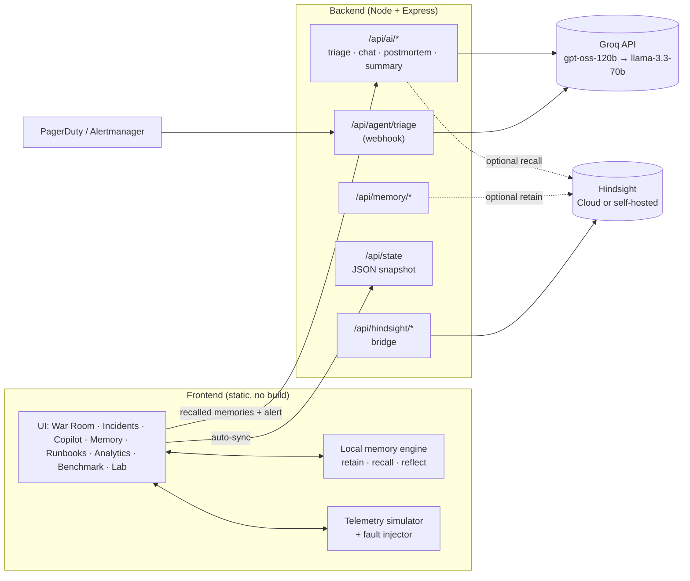

# Architecture

## Overview



The frontend is fully functional on its own. The backend adds **Groq reasoning**, **persistence/sync** and the **Hindsight bridge**. If the backend is unreachable the UI silently falls back to its local engine.

## The memory model

Every memory is a small record:

```jsonc
{
  "id": "k3j2h1", "cat": "episodic",        // episodic | fact | reflection | runbook
  "title": "INC-2026-9013: Connection pool exhaustion on auth-service",
  "text": "Symptoms: … Logs: … Root cause: … Resolution: …",
  "service": "auth-service", "fault": "conn_leak",
  "steps": ["Run drain_db_connections.sh --force", "…"],
  "mttr": 4, "ts": 1790000000000, "recalls": 3, "tok": ["auth-service", "connection", …]
}
```

| Category | Meaning | Created by |
|---|---|---|
| `episodic` | One specific past incident | Resolving an incident |
| `runbook` | The proven procedure for a failure pattern | First post-mortem of a new pattern (editable) |
| `reflection` | A consolidated lesson across incidents | `reflect()` after ≥ 2 resolved incidents of one type |
| `fact` | Stable knowledge (architecture, policy) | Seed data, Memory Explorer, Copilot (`remember that …`) |

### retain

`learn(fault, {service, steps, root, mttr, inc})` writes an episodic memory and, if none exists for that failure pattern, a runbook. `API.mirror()` forwards the post-mortem to Hindsight when the bridge is enabled.

### recall

For a query *q* and memory *m*:

```
cos(q, m)  = Σ w(t,q)·w(t,m) / (‖q‖·‖m‖)          w(t,d) = (1 + ln tf) · ln(1 + (N+1)/(df+1))
score(q,m) = cos + 0.06·[same service] + 0.04·e^(−age/45d) + min(0.06, 0.004·recalls)
```

Tokens are lower-cased, stop-words removed, hyphenated names split (`auth-service` → `auth-service`, `auth`, `service`), and a trailing plural “s” stripped. Reinforcement means memories that repeatedly help rank slightly higher.

### diagnose (recall → vote)

1. Recall the top 6 memories for the alert (symptoms + logs + service).
2. Only memories with a `fault` tag **and** cosine ≥ 0.24 may vote. Each vote is weighted by its score.
3. The winning `fault` is the diagnosis. Steps come from its runbook, the root cause from its newest episodic memory.
4. Confidence = `55 + 45·cos(top) + min(8, 2·#agreeing memories)`, clamped to 60–98.
5. No qualifying votes → *unknown pattern*: confidence 38–58, generic fallback, and the UI asks you to retain a post-mortem.

Facts (which have no `fault`) never vote, but are shown as context. That is why the agent can say *“I recalled the api-gateway TLS fact but have no proven runbook.”*

### reflect

`reflect()` rewrites one reflection per failure type: occurrences, services affected, average MTTR, how many were resolved by the recalled runbook, best action and what to avoid. Reflections are themselves recallable and vote like runbooks.

## The AI layer

`POST /api/ai/triage` takes the incident plus the **locally recalled** memories:

| `mode` | Memories sent | Purpose |
|---|---|---|
| `stateless` | none | The honest “before”: what an LLM says from the alert alone |
| `memory` | top hits (+ Hindsight recall if enabled) | The “after”: grounded, cites `usedMemoryIds`, honest confidence |

Prompts require a strict JSON object. The backend extracts it robustly (`<think>` blocks, fences, trailing commas), retries once with a stricter reminder, then normalises and clamps every field before returning it.

**Reliability:** primary model → fallback model, one retry with back-off on 429/5xx, per-request timeout, explicit error codes (`ai_not_configured`, `ai_bad_key`, `ai_rate_limited`, `ai_timeout`, `ai_bad_json`, …).

**What stays simulated:** the telemetry, and whether an executed plan “works”. Executing the memory agent's plan succeeds only when its diagnosed pattern matches the injected failure; the stateless plan always fails (it is the generic advice that treats the symptom). The AI text is real; the outcome is the game logic.

## Frontend structure

Classic `<script>` files share one global scope (no bundler):

| File | Responsibility |
|---|---|
| `core.js` | helpers, `FAULTS` catalogue, `S` (state), `SV`/`LIVE` (telemetry) |
| `memory.js` | `tok`, `recall`, `learn`, `reflect` |
| `incidents.js` | `newIncident`, `diagnose`, `runTriage`, `resolveInc`, `stats`, `genSeed`, `tick` |
| `api.js` | `API` client, `fmt` markdown, AI badge and cards |
| `ui.js` | charts, nav, palette, confetti, hero, stagger |
| `pages.js` | one `PAGES.<id> = {title, fn, after}` per screen |
| `actions.js` | `ACT` handlers + delegated events |
| `main.js` | `go`, `render`, `boot` |

To add a screen: add a `PAGES.foo`, add it to `NAV_GROUPS` in `ui.js`.

## Backend structure

`src/server.js` exports `createApp({store})` (used by the tests) and listens when run directly. Routes are thin; logic lives in `services/`.

## Swapping in real Hindsight as the primary memory

The bridge (`/api/hindsight/*`) mirrors and augments. To make Hindsight the *only* store, replace `learn()`, `recall()` and `reflect()` in `frontend/js/memory.js` with calls to a backend route that wraps `HindsightClient.retain / recall / reflect`, and keep the same return shapes (`{m, cos, score}`). Everything else, including diagnosis voting, works unchanged as long as retained memories carry `fault` metadata (store it in Hindsight `tags` / `metadata`).
